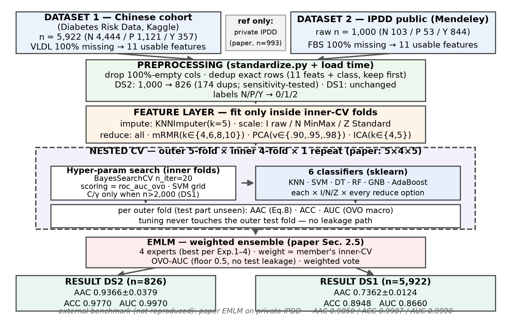
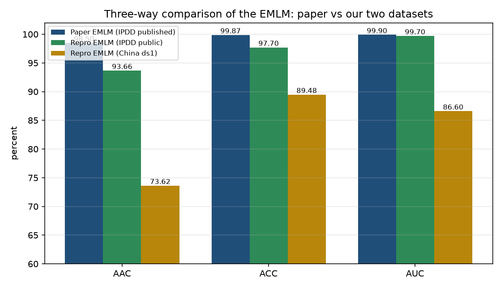
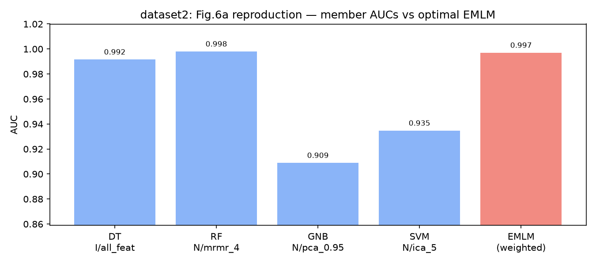
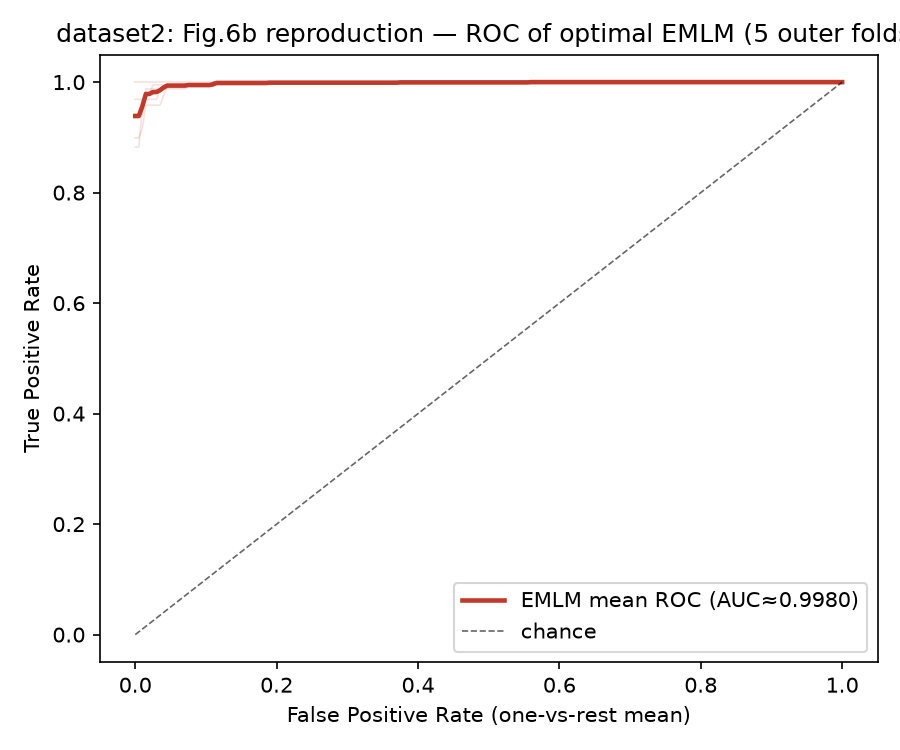
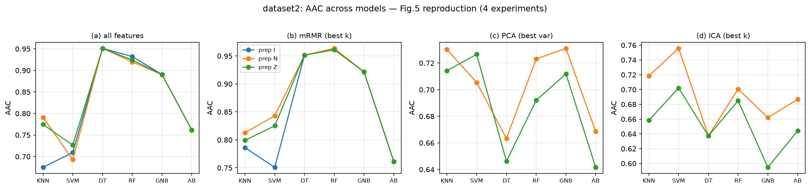

# EMLM Diabetes Reproduction

A faithful, **fully documented** reproduction of the **EMLM** (Ensemble of Machine
Learning Multi-classifier models) pipeline from:

> Abnoosian K., Farnoosh R., Behzadi M.H., *Prediction of diabetes disease using an
> ensemble of machine learning multi-classifier models*, **BMC Bioinformatics** 24:337 (2023).
> <https://doi.org/10.1186/s12859-023-05465-z>

## What is this project?

Early diagnosis of type-2 diabetes from **11 routine blood-test features**
(Gender, AGE, Urea, Cr, FBS/HbA1c, Chol, TG, HDL, LDL, VLDL/BMI), formulated as a
**three-class** problem:

| class | meaning |
|---|---|
| **N** | Non-diabetic |
| **P** | Predicted-diabetic (pre-diabetes — the hard, clinically valuable class) |
| **Y** | Diabetic |

The paper's EMLM combines six classifiers (**KNN, SVM, Decision Tree, Random
Forest, Gaussian Naive Bayes, AdaBoost**) tuned via *nested cross-validation* with
*Bayesian hyper-parameter search*, then fuses their class probabilities with
AUC-derived weights. This repository re-runs that entire protocol end-to-end on
two real public datasets and reports **every** place where our execution deviates
from the published one.



*The pipeline as actually executed: standardize → dedup → 5-fold outer CV with
inner 4-fold Bayesian tuning (impute → scale → mRMR/PCA/ICA → model, all inside
fold) → AUC-weighted committee → OOF metrics.*

## The pipeline in one table

| stage | what runs | where |
|---|---|---|
| Standardize | raw CSVs → canonical 15-column schema | `pipeline/standardize.py` + `configs/` |
| Dedup | exact match on 11 features + class, keep first | `preprocessing.py` (at load time) |
| Impute / Scale | **kNN k=5** → **I** (none) / **N** (MinMax) / **Z** (Standard) | inside the sklearn `Pipeline` → fitted only on each train fold |
| Feature selection | **mRMR** k∈{4,6,8,10} (approx., F-score relevance) · **PCA** {90,95,98}% · **ICA** {4,5} | same pipeline — no leakage |
| Models & tuning | 6 classifiers, full paper grids, `BayesSearchCV` inner 4-fold, scoring `roc_auc_ovo` | `nested_cv.py` |
| Experiments | the paper's four tables: Exp1 no-selection, Exp2 mRMR, Exp3 PCA, Exp4 ICA | `notebooks/02_experiments.ipynb` |
| EMLM | committee = best cell per experiment; weight = **inner-CV OVO-AUC (floor 0.5)**; weighted `predict_proba` → argmax | `ensemble.py` |
| Verification | OOF `argmax(P)==y_pred` (0/6748 mismatches); AUC rebuilt via Mann–Whitney U matches `roc_auc_score` to machine precision | stored in `results/*_emlm_oof.csv` |

## Results

All numbers below come straight from the committed CSVs in
`pipeline/results/` — nothing is hand-typed. Full tables:
[`docs/RESULTS.md`](docs/RESULTS.md).

### Headline (equivalent of the paper's Table 9)

| dataset | n | AAC | ACC | AUC |
|---|---|---|---|---|
| **Dataset2 — IPDD public** (the paper's public dataset) | 826 | **0.9366 ± 0.0379** | 0.9770 | 0.9970 |
| **Dataset1 — Chinese cohort** (our generality check) | 5922 | **0.7362 ± 0.0124** | 0.8948 | 0.8660 |
| *Paper EMLM (private post-merge IPDD)* | *993* | *0.9850* | *0.9987* | *0.9990* |



*Paper numbers are on its private dataset (with a correspondence-only FBS column
that was never made public — see [docs/DATA.md](docs/DATA.md)). The honest gap
analysis, including a sensitivity experiment that made us **retract our own first
explanation**, is in [docs/DEVIATIONS.md](docs/DEVIATIONS.md) §7.*

### Per-class behavior (Dataset2, pooled out-of-fold confusion matrix)

| | predicted N | predicted P | predicted Y | sensitivity |
|---|---|---|---|---|
| **actual N** | 91 | 0 | 5 | 0.9479 |
| **actual P** | 0 | 35 | 5 | 0.8750 |
| **actual Y** | 9 | 0 | 681 | 0.9870 |

Mean sensitivity = **AAC 0.9366** — the pre-diabetic minority class (P) is where
the real clinical difficulty sits.

### What each experiment produced (best single cell per table)

| experiment (paper table) | Dataset2 best cell | Dataset1 best cell |
|---|---|---|
| Exp1 — no selection (Table 5) | DT, prep N — AAC 0.9513 | RF, prep Z — AAC 0.7375 |
| Exp2 — mRMR (Table 6) | RF, mrmr_4, prep N — AAC 0.9637 | RF, mrmr_10, prep Z — AAC 0.7377 |
| Exp3 — PCA (Table 7) | GNB, pca_0.95, prep N — AAC 0.7311 | SVM, pca_0.98, prep Z — AAC 0.6635 |
| Exp4 — ICA (Table 8) | SVM, ica_5, prep N — AAC 0.7558 | RF, ica_5, prep Z — AAC 0.5687 |

These four best cells form the EMLM committee; their weighted fusion outperforms
the ensemble's variance (fold std shrinks vs. the raw best member).

### Reproduced figures (paper Figs. 5, 6a, 6b, 7)



*EMLM vs. each committee member on Dataset2 — AUC recomputed independently from
the stored out-of-fold probabilities.*



*Mean ROC over the 5 outer folds (one-vs-rest convention is used for plotting
only; all reported AUC numbers are OvO macro).*



All figures are regenerable from the result CSVs:
`python src/make_figures.py dataset2` — no fabricated data anywhere.

## What was reproduced / what was not

| Paper artifact | Status here |
|---|---|
| Tables 5–8 (I/N/Z × {mRMR, PCA, ICA} × 6 classifiers) | ✅ full grid, both datasets (151/150 cells) |
| Table 9 EMLM metrics | ✅ on dataset2 (IPDD) and dataset1 |
| Table 10 / Fig. 7 external comparison | ✅ with real numbers |
| Figs. 5, 6a, 6b | ✅ redrawn from result CSVs |
| Paper's private dataset (n=993, private FBS) | ❌ not public — we use the public IPDD file |
| LASSO / RFE / SVRFE | ❌ **never executed** — conceptual comparison only |

## Repository layout

```
pipeline/
  standardize.py         raw → canonical 15-column schema (per-dataset configs)
  configs/               dataset1.json / dataset2.json (column + label mappings)
  data/                  standardized CSVs (the only tabular input notebooks read)
  src/                   preprocessing.py · models.py · nested_cv.py · ensemble.py
                         make_figures.py · make_pipeline_figure.py
  results/               all experiment CSVs (tables 5–10, committee, OOF, sensitivity)
  figures/  outputs/     figures + EDA audit JSONs
notebooks/               01_eda · 02_experiments · 03_emlm (dataset-agnostic)
run_dedup_sensitivity.py controlled pre/post-dedup comparison (DEVIATIONS §7)
docs/                    DATA.md · RESULTS.md · DEVIATIONS.md
```

## Quick start

```bash
pip install -r requirements.txt   # numpy 2.x, scikit-learn 1.9, scikit-optimize ...
cd pipeline
jupyter lab ../notebooks/
```

Set `DATASET` (`"dataset1"` / `"dataset2"`) and `FAST` in each notebook's first
cell, then Run All. `FAST=True` is a multi-minute smoke run; `FAST=False`
reproduces the reported tables (hours — see DEVIATIONS §1).

## Datasets, honesty policy, license

- Provenance, **CC BY 4.0** license for IPDD, column mappings, encodings,
  missingness: [docs/DATA.md](docs/DATA.md).
- Every departure from the paper, with rationale and measured evidence:
  [docs/DEVIATIONS.md](docs/DEVIATIONS.md). The governing rule of this project:
  **no change without a documented reason.**
- Code and figures: MIT (`LICENSE`). Data tables stay under their original licenses.

**فارسی:** نسخه‌ی کامل فارسی همین صفحه در [`README_fa.md`](README_fa.md).

## Citation

If you reuse this reproduction, please cite the original paper above and the
datasets as described in `docs/DATA.md`.
