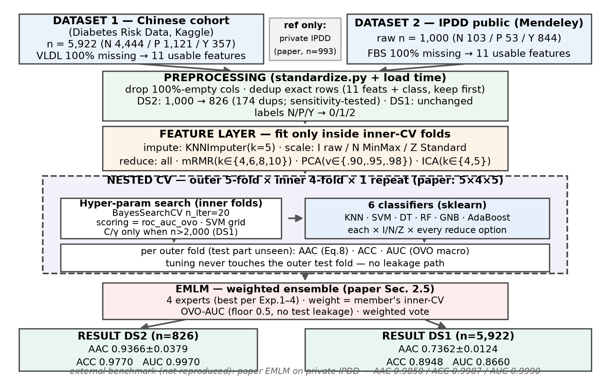
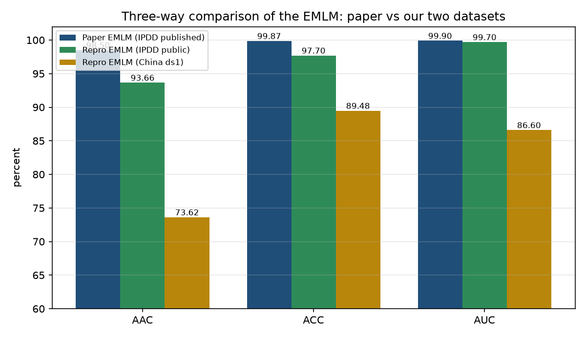
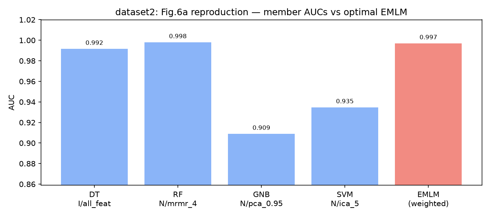
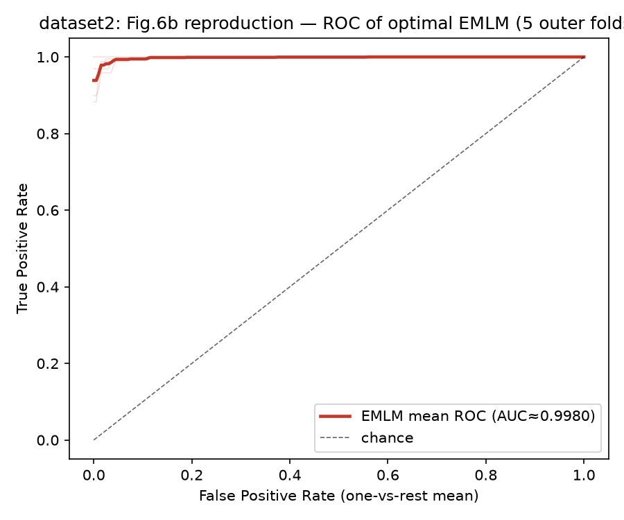
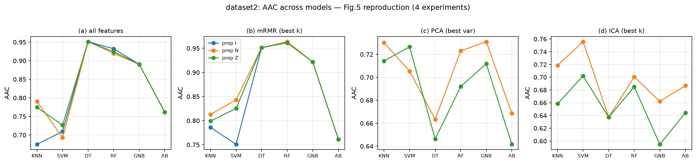

# بازتولید EMLM — پیش‌بینی دیابت (BMC Bioinformatics 2023)

بازتولیدِ **وفادار و کاملاً مستند**ی از خطِ لوله‌ی **EMLM** (Ensemble of Machine
Learning Multi-classifier models) در مقاله:

> Abnoosian K., Farnoosh R., Behzadi M.H., *Prediction of diabetes disease using an
> ensemble of machine learning multi-classifier models*, **BMC Bioinformatics** 24:337 (2023).
> <https://doi.org/10.1186/s12859-023-05465-z>

## این پروژه چیست؟

تشخیصِ زودهنگامِ دیابت نوع ۲ از **۱۱ ویژگیِ رایجِ آزمایش خون** (جنسیت، سن، اوره،
کراتینین، قند ناشتا/HbA1c، کلسترول، تری‌گلیسرید، HDL، LDL، VLDL/BMI) در قالبِ یک
مسئله‌ی **سه‌کلاسه**:

| کلاس | معنا |
|---|---|
| **N** | سالم (Non-diabetic) |
| **P** | مرزی/احتمالِ دیابت (پردیابت — کلاسِ سخت و از نظرِ بالینی ارزشمند) |
| **Y** | دیابتی |

روشِ EMLM مقاله، شش طبقه‌بند (**KNN، SVM، درخت تصمیم، جنگل تصادفی، بیز ساده،
آدابوست**) را با *اعتبارسنجیِ متقاطعِ تودرتو* و *جستجویِ بیزیِ هایپرپارامتر* تنظیم
می‌کند و سپس احتمالاتِ کلاسِ آن‌ها را با وزن‌هایِ مشتق‌شده از AUC ادغام می‌کند.
این مخزن تمامِ آن پروتکل را سرِ‌به‌سر روی **دو پایگاهِ داده‌ی واقعی و عمومی** دوباره
اجرا کرده و **هر** جایی که نحوه‌ی اجرا با متنِ مقاله فرق دارد را مستند کرده است.



*خطِ لوله‌ی واقعیِ اجراشده: استانداردسازی ← حذف تکراری ← CV تودرتو (impute،
مقیاس‌گذاری، mRMR/PCA/ICA و مدل — همه داخل فولدِ آموزش) ← کمیته‌ی وزن‌دار با AUC ←
معیارهای OOF.*

## خلاصه‌ی روش در یک جدول

| مرحله | چه چیزی اجرا می‌شود | کجا |
|---|---|---|
| استانداردسازی | CSVهای خام ← اسکیمای کنونیکال ۱۵ ستونی | `pipeline/standardize.py` + `configs/` |
| حذف تکراری | تطابق کامل ۱۱ فیچر + کلاس، نگه‌داشتن اولی | `preprocessing.py` (هنگام بارگذاری) |
| impute / مقیاس | **kNN با k=5** ← **I** (بدون مقیاس) / **N** (MinMax) / **Z** (Standard) | داخل `Pipeline` — فقط روی بخش آموزش هر فولد fit می‌شود |
| انتخاب ویژگی | **mRMR** با k∈{4,6,8,10} (تقریبی، relevance با F-score) · **PCA** {۹۰،۹۵،۹۸٪} · **ICA** {4,5} | همان pipeline — بدون نشت |
| مدل و تنظیم | ۶ مدل، گریدهای کامل مقاله، `BayesSearchCV` درونی ۴-فولد، امتیاز `roc_auc_ovo` | `nested_cv.py` |
| چهار آزمایش | جداول ۵–۸ مقاله: بدون‌انتخاب / mRMR / PCA / ICA | `notebooks/02_experiments.ipynb` |
| EMLM | کمیته = بهترین سلول هر آزمایش؛ وزن = **AUCِ لایه درونی (کف ۰٫۵)**؛ میانگین وزنی `predict_proba` → argmax | `ensemble.py` |
| صحت‌سنجی | `argmax(P)==y_pred` روی OOF (۰ خطا از ۶۷۴۸ سطر)؛ AUC بازسازی‌شده با Mann–Whitney U دقیقاً می‌خواند | `results/*_emlm_oof.csv` |

## نتایج

همه‌ی اعدادِ زیر مستقیماً از CSVهای commit‌شده در `pipeline/results/` می‌آیند —
هیچ عددی دستی تایپ نشده. جدول‌های کامل: [`docs/RESULTS.md`](docs/RESULTS.md).

### عدد اصلی (معادل جدول ۹ مقاله)

| پایگاه | n | AAC | ACC | AUC |
|---|---|---|---|---|
| **Dataset2 — IPDD عمومی** (همان پایگاه عمومی مقاله) | 826 | **0.9366 ± 0.0379** | 0.9770 | 0.9970 |
| **Dataset1 — کوهورت چینی** (سنجش عمومیت ما) | 5922 | **0.7362 ± 0.0124** | 0.8948 | 0.8660 |
| *EMLM مقاله (IPDD خصوصی)* | *993* | *0.9850* | *0.9987* | *0.9990* |



*اعدادِ مقاله روی پایگاهِ خصوصیِ خودش است (با ستونِ FBS که هرگز عمومی نشد —
توضیح در [docs/DATA.md](docs/DATA.md)). تحلیلِ صادقانۀ شکاف — شاملِ یک آزمایشِ
حساسیت‌سنجی که باعث شد **خودِ اولین توضیحِ خودمان را پس بگیریم** — در
[docs/DEVIATIONS.md](docs/DEVIATIONS.md) بخش ۷ آمده است.*

### رفتار کلاس‌محور (Dataset2، ماتریس سردرگمیِ تجمیعیِ OOF)

| | پیش‌بینی N | پیش‌بینی P | پیش‌بینی Y | حساسیت |
|---|---|---|---|---|
| **واقعی N** | 91 | 0 | 5 | 0.9479 |
| **واقعی P** | 0 | 35 | 5 | 0.8750 |
| **واقعی Y** | 9 | 0 | 681 | 0.9870 |

میانگینِ حساسیت‌ها = **AAC همان 0.9366** — کلاسِ اقلیتِ پردیابت (P) دقیقاً همان‌جایی
است که سختیِ واقعیِ مسئله و ارزشِ بالینی نهفته است.

### خروجی هر آزمایش (بهترین سلول تک هر جدول)

| آزمایش (جدول مقاله) | بهترین در Dataset2 | بهترین در Dataset1 |
|---|---|---|
| Exp1 — بدون انتخاب (جدول ۵) | DT، مسیر N — AAC‏ 0.9513 | RF، مسیر Z — AAC‏ 0.7375 |
| Exp2 — mRMR (جدول ۶) | RF‏، mrmr_4، مسیر N — AAC‏ 0.9637 | RF‏، mrmr_10، مسیر Z — AAC‏ 0.7377 |
| Exp3 — PCA (جدول ۷) | GNB‏، pca_0.95، مسیر N — AAC‏ 0.7311 | SVM، pca_0.98، مسیر Z — AAC‏ 0.6635 |
| Exp4 — ICA (جدول ۸) | SVM، ica_5، مسیر N — AAC‏ 0.7558 | RF، ica_5، مسیر Z — AAC‏ 0.5687 |

همین چهار سلولِ برتر، کمیته‌ی EMLM را می‌سازند و ادغامِ وزن‌دارشان، واریانسِ
فولد‌به‌فولدِ بهترِینِ عضو را هم کم می‌کند.

### شکل‌های بازتولیدشده (معادل شکل‌های ۵، 6a، 6b و ۷ مقاله)



*EMLM در برابر تک‌تک اعضای کمیته روی Dataset2 — AUC مستقلّاً از احتمالاتِ OOFِ
ذخیره‌شده دوباره حساب شده است.*



*میانگین ROC روی ۵ فولدِ بیرونی (کنوانسیون one-vs-rest فقط برای رسم است؛ همه
اعدادِ AUCِ گزارش‌شده OvO macro هستند).*



همه شکل‌ها با `python src/make_figures.py dataset2` از CSVهای نتایج بازتولید
می‌شوند — هیچ داده‌ی ساختگی در نمودارها نیست.

## چه چیزی بازتولید شد / چه چیزی نشد

| هنرِ مقاله | وضعیت اینجا |
|---|---|
| جداول ۵–۸ (I/N/Z × {mRMR, PCA, ICA} × ۶ مدل) | ✅ گرید کامل روی هر دو پایگاه (۱۵۱/۱۵۰ سلول) |
| جدول ۹ (معیارهای EMLM) | ✅ روی dataset2 (IPDD) و dataset1 |
| جدول ۱۰ / شکل ۷ (مقایسه بیرونی) | ✅ با اعداد واقعی |
| شکل‌های ۵، 6a، 6b | ✅ بازترسیم از CSVهای نتایج |
| پایگاه خصوصی مقاله (۹۹۳ ردیف با FBS خصوصی) | ❌ عمومی نیست — از نسخه عمومی IPDD استفاده شد |
| LASSO / RFE / SVRFE | ❌ **اجرا نشدند** — فقط مقایسه مفهومی |

## ساختار مخزن

```
pipeline/
  standardize.py         تبدیل خام ← اسکیمای کنونیکال ۱۵ ستونی (کانفیگ هر پایگاه)
  configs/               dataset1.json / dataset2.json (نگاشت ستون و برچسب)
  data/                  CSVهای استانداردشده (تنها ورودی جدولی نوتبوک‌ها)
  src/                   preprocessing.py · models.py · nested_cv.py · ensemble.py
                         make_figures.py · make_pipeline_figure.py
  results/               همه CSVهای نتایج (جداول ۵–۱۰، کمیته، OOF، حساسیت‌سنجی)
  figures/  outputs/     شکل‌ها + JSONهای audit
notebooks/               01_eda · 02_experiments · 03_emlm (دیتاست-مستقل)
run_dedup_sensitivity.py مقایسه کنترل‌شده پیش/پس از dedup (DEVIATIONS §۷)
docs/                    DATA.md · RESULTS.md · DEVIATIONS.md
```

## شروع سریع

```bash
pip install -r requirements.txt   # numpy 2.x، scikit-learn 1.9، scikit-optimize ...
cd pipeline
jupyter lab ../notebooks/
```

در سلولِ اول هر نوتبوک `DATASET` (‏`dataset1` / `dataset2`) و `FAST` را تنظیم کنید و
Run All. حالت `FAST=True` یک دودِ چنددقیقه‌ای است؛ `FAST=False` جداول گزارش‌شده را
بازتولید می‌کند (چند ساعت — بخش ۱ِ DEVIATIONS).

## پایگاه‌های داده، سیاست صداقت، مجوز

- منبع، لایسنس **CC BY 4.0** برای IPDD، نگاشت ستون‌ها، کدگذاری‌ها و گمشده‌ها:
  [docs/DATA.md](docs/DATA.md).
- هر انحراف از مقاله، با دلیل و شواهد اندازه‌گیری‌شده:
  [docs/DEVIATIONS.md](docs/DEVIATIONS.md). قانون حاکم بر پروژه:
  **هیچ تغییری بدون ثبتِ دلیل.**
- کد و شکل‌ها: MIT (`LICENSE`). جدول‌های داده زیر لایسنس منبع خودشان هستند.

**English:** the full English version of this page is in [`README.md`](README.md).

## ارجاع

در صورت استفاده از این بازتولید، لطفاً به مقاله‌ی بالا و به پایگاه‌های داده طبق
توضیح `docs/DATA.md` استناد کنید.
